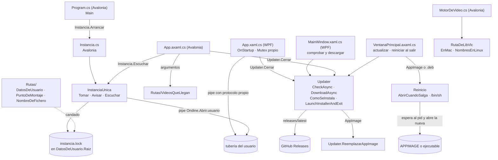

# Arranque, actualización y una sola instancia

**Qué hace:** decide si esta copia de Ondine es la única abierta (y, si no lo es, pasa los
vídeos a la que ya corre), comprueba en GitHub Releases si hay versión nueva, descarga el
paquete que le toca a esta instalación y lo entrega según el sistema (Windows lo instala y se
cierra; Linux y macOS lo abren con su programa o sustituyen el AppImage). En Linux reabre la
aplicación tras la actualización. `Rutas/` da los lugares del usuario (datos, nubes, volúmenes,
nombres) que el arranque necesita, y `RutaDeLibVlc` dice dónde está libvlc en macOS y Linux.

En Linux el `.deb` sale en dos arquitecturas (amd64 y arm64), y `DebDeLinux` baja el de la
máquina. Cuando el CI tiene la clave de firma, cada versión se publica también en un repositorio
apt firmado: así el gestor de actualizaciones de Debian, Mint o Ubuntu ve Ondine como cualquier
otro paquete. Ver «Repositorio apt» más abajo.

## Repositorio apt

- **Dónde está.** La rama `apt` del repositorio guarda `dists/`, `pool/` y la parte pública de la
  clave. `pages.yml` la copia bajo `web/dist/apt` y se sirve en https://ondine.hdglabs.com/apt.
- **Quién lo hace.** El job `publicar-apt` de `build.yml`, solo en tags, después de que el `.deb`
  esté montado. Solo guarda la versión actual, para que el sitio no pese de más (1 GB en Pages).
- **Sin clave, nada.** Si falta el secreto `GPG_PRIVATE_KEY`, el job avisa y no publica. Un
  repositorio sin firmar lo rechaza apt, así que es mejor no tocarlo.
- **Qué lleva el `.deb`.** Si existe `empaquetado/linux/ondine-archive-keyring.gpg`, el paquete
  instala la clave en `/usr/share/keyrings` y la fuente en `/etc/apt/sources.list.d/ondine.sources`.
  Quien instala el `.deb` queda apuntado al repositorio sin hacer nada más.
- **Secretos del CI.** `GPG_PRIVATE_KEY` (la clave privada, en base64) y `GPG_PASSPHRASE`.

## Piezas y dependencias

## Huecos conocidos

- **WPF no usa `InstanciaUnica`.** Tiene su propio `Mutex` («OndineSingleInstanceMutex») y su
  propio protocolo de tubería, con el mismo nombre de tubería que Avalonia. Por el código, con
  las dos interfaces abiertas no hay una sola instancia, y un «Abrir con» entre ellas se pierde:
  WPF manda texto sin byte de fin ni acuse, y `InstanciaUnica` solo acepta avisos terminados en
  byte 0 y acusados. No se ha probado en ejecución.
- **Dos caminos de actualización en Linux.** Con el repositorio configurado, el gestor del sistema
  ofrece la versión nueva, y la app sigue bajando su propio `.deb` y abriendo el instalador. Es
  redundante, no incorrecto: pendiente decidir si la app se calla cuando la instalación viene del
  repositorio (se detectaría con `/etc/apt/sources.list.d/ondine.sources`).
- **El repositorio depende de una clave que solo guarda el dueño del proyecto.** Si se filtra hay
  que rotarla, y si se pierde no se pueden publicar versiones que apt acepte.
- **La descarga no se verifica.** `Updater.DownloadAsync` no comprueba suma ni firma: el
  instalador de Windows se lanza solo porque su nombre encaja y viene de GitHub. Firmar el
  instalador está pendiente en el ROADMAP, pero hasta entonces no hay nada más que el origen.
- **El tiempo de espera cubre la descarga entera.** El `HttpClient` compartido tiene 30 s de
  `Timeout`, y ese plazo, según la documentación de `HttpClient`, incluye la lectura del cuerpo:
  un instalador grande en una conexión lenta puede abortar. `DownloadAsync` tampoco recibe un
  `CancellationToken`, así que la interfaz no puede cancelarla.
- **En macOS, «Abrir con» no entrega el vídeo.** El propio `App.axaml.cs` lo deja dicho: macOS
  manda los ficheros como evento del sistema y ese evento no se atiende todavía.
- **Dos espacios de nombres en `Rutas/`.** Unos ficheros declaran `namespace Ondine` y otros
  `namespace Ondine.Rutas` (`NubesDelEquipo`, `VerEnLaNube` y `VideosQueLlegan` son los segundos).
  No rompe nada, pero obliga a recordar qué `using` hace falta.
