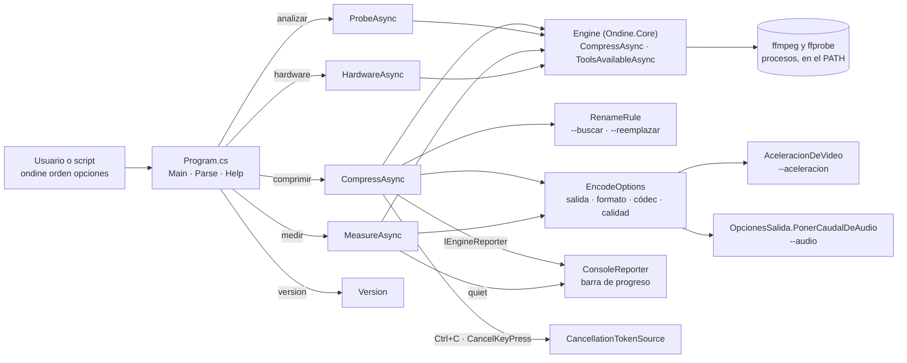

# Línea de comandos (CLI)

**Qué hace:** da las órdenes `comprimir`, `analizar`, `medir`, `hardware` y `version` desde el terminal, en Linux, macOS y Windows, con el mismo motor que la app de escritorio. Es un proyecto que referencia `Ondine.Core`, y `Program.cs` contiene todo: el reparto de órdenes, el análisis de opciones, la ayuda y el reportero de consola.

## Piezas y dependencias

## Huecos conocidos

- **Los errores de uso salen con código 1, no con 2.** `Parse` lanza `ArgumentException` ante una
  opción desconocida o un valor que falta, y el `catch` general lo convierte en «Error:» con
  código 1. Mientras, «Indica al menos un archivo» y «Orden desconocida» devuelven 2.
- **`comprimir` termina con código 0 aunque no salga nada.** Si ningún fichero se genera, o si
  alguno falla, el comando devuelve 0. El resumen solo cuenta los correctos y no menciona los
  fallidos, así que un script no puede detectar el fallo por el código de salida.
- **Un fichero indicado a mano se acepta sin mirar su extensión.** La rama `File.Exists` de
  `Collect` no filtra por `Engine.VideoExtensions`; solo las carpetas lo hacen. Así,
  `comprimir notas.txt` llega al motor.
- **`--formato`, `--codec` y `--aceleracion` no validan su valor.** `Parse` asigna lo que llegue.
  Según el comentario, un nombre de aceleración que no arranque en esta máquina se resuelve como
  automática al usarlo, y un nombre mal escrito no avisa.
- **`analizar` y `medir` no comprueban ffmpeg ni ffprobe antes de empezar.** Solo `comprimir`
  llama a `Engine.ToolsAvailableAsync()`. Sin las herramientas, el error sale por el `catch`
  general con el texto que dé la excepción.
- **`analizar` no aísla un fallo por fichero.** El bucle no tiene `try`: si `ProbeAsync` lanza en
  un fichero, los siguientes no se analizan y el comando termina con «Error:» y código 1.
- **`medir` no coopera con la cancelación.** Pasa `CancellationToken.None` y no engancha Ctrl+C
  (eso solo lo hace `comprimir`), así que la interrupción corta el proceso sin el «Cancelado.» y
  el código 130.
- **Ninguna prueba ejecuta la CLI.** La única que lee `src/Ondine.Cli/Program.cs`
  (`PistasQueSeQuedanTests.cs`) comprueba que la ayuda mencione `--idiomas` y «all». El análisis de
  opciones, los códigos de salida y la cancelación no tienen cobertura.
