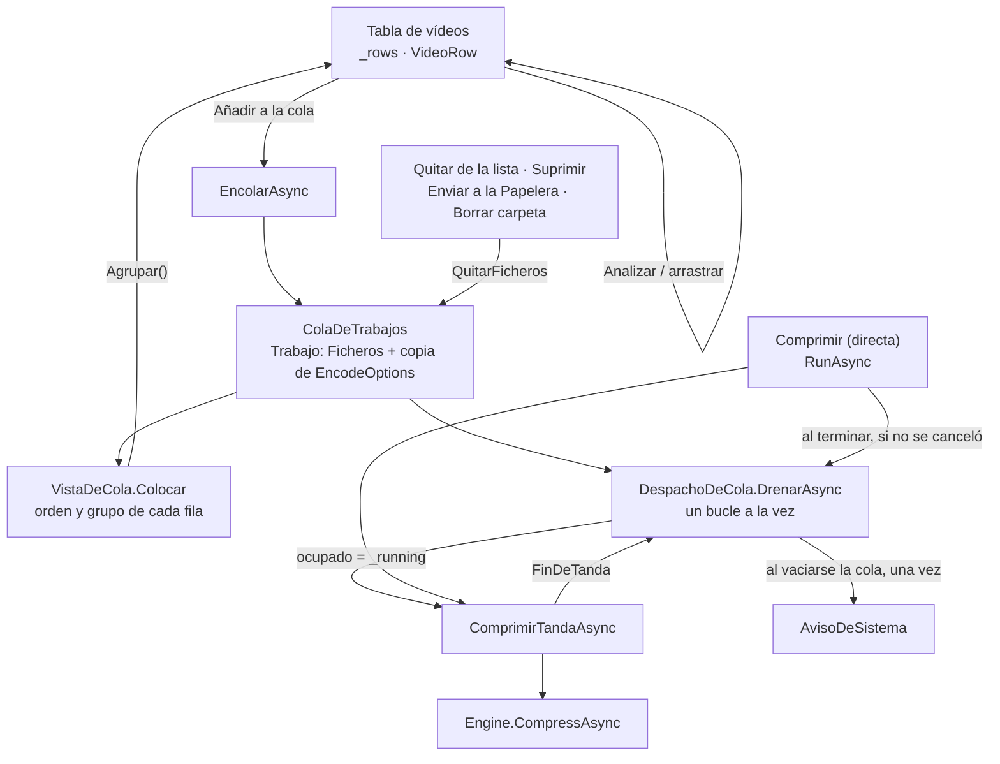

# Cola de trabajos y panel Comprimir

**Qué hace:** deja comprimir varias tandas con ajustes distintos sin esperar. Cada trabajo guarda
su copia de las opciones y su lista de ficheros, y `DespachoDeCola` los lanza de uno en uno.
La tabla de Comprimir es la vista de la cola: lo encolado va arriba, en su orden, y lo analizado
que no está en la cola va debajo, cada grupo con su cabecera.

## Piezas y dependencias

## Reglas que no se deben romper

1. **Un solo bucle de despacho.** `DespachoDeCola` no arranca un segundo bucle mientras el
   primero vive. Lo añadido a mitad lo recoge el que está en marcha.
2. **Una compresión directa no es la cola, pero la cola espera a que acabe.** Al terminar la
   directa se vuelve a vaciar la cola, salvo que se haya cancelado.
3. **Quitar de la lista también saca el fichero de la cola** (`QuitarFicheros`). El trabajo en
   curso no se toca; la fila se queda y la barra de estado lo dice.
4. **Cancelar detiene la cola entera.** Lo que queda sigue pendiente.
5. **La pertenencia a la cola se pregunta a la cola**, no se guarda en la fila. `VistaDeCola`
   es la única que decide el grupo.
6. **Cada vídeo encolado es su propio trabajo.** Así la columna Orden de la tabla mueve un vídeo
   cada vez. Lo que se está comprimiendo no se mueve (`PuedeMoverse`).
7. **Un solo aviso por cola vaciada**, con el total de todas sus tandas. Cancelar lo anula.

## Huecos conocidos

- **Enviar a la Papelera un fichero que está en curso** no se evita: `DeleteSelected` no mira si
  el trabajo en curso lo está usando.
- **La cabecera de grupo en WPF ocupa la columna VÍDEO**, no toda la fila como en Avalonia.
- **Ordenar por columna** puede mezclar los grupos: la banda sale en cada cambio de grupo, no
  se reordena sola.
- **MCP tiene su propio mecanismo de tandas** (`src/Ondine.Mcp/Tandas.cs`), que no usa
  `ColaDeTrabajos`. Dos colas que se pueden desincronizar.
- **Sin comprobación de interfaz en WPF.** La tabla de Avalonia sí tiene una en `--auto`
  (`CorrerAgrupadoDeComprimir`).
