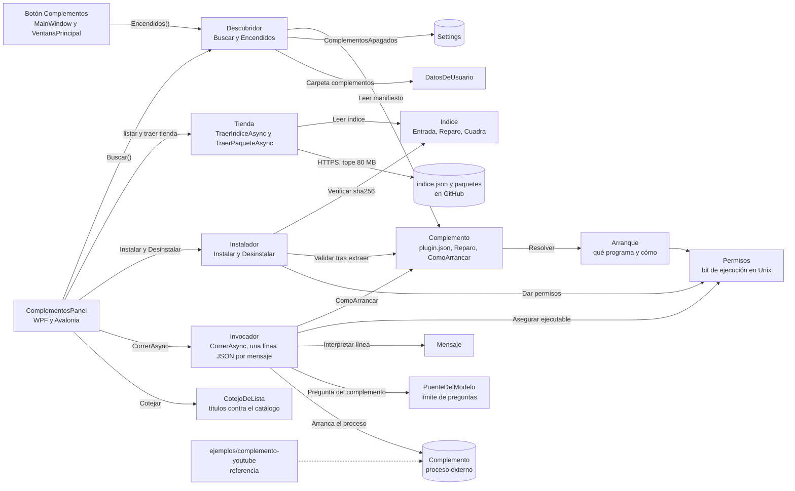

# Complementos y tienda

**Qué hace:** ejecuta programas de fuera como procesos (por ejemplo, el complemento de YouTube),
los descubre en su carpeta, los instala desde el índice oficial verificando su sha256 y les habla
por JSON en la salida estándar. El panel los lista, los enciende o apaga y deja traer episodios
o películas desde ellos.

## Piezas y dependencias

## Huecos conocidos

- **El interruptor de encendido no se guarda en WPF.** `src/Ondine/ComplementosPanel.xaml` enlaza
  `Activo` en modo TwoWay, pero `ComplementosPanel.xaml.cs` nunca lee ni escribe
  `ComplementosApagados`, y el valor arranca siempre en `true`. Apagar un complemento en WPF no
  persiste: al volver a abrir el panel sale encendido, y el botón de la barra (que usa
  `Descubridor.Encendidos`) sigue ofreciéndolo. En Avalonia sí se guarda.
- **Nada prueba que un complemento apagado deje de ofrecerse.** `Descubridor.Encendidos` filtra por
  `ComplementosApagados`, pero ninguna prueba de `tests/Reindex.Tests` la llama.
- **Reinstalar no es atómico.** `Instalador.Instalar` borra la versión anterior antes de mover la
  nueva (`Directory.Delete` y luego `Directory.Move`). Si el movimiento falla en ese hueco, la
  versión que funcionaba ya no está, lo que contradice el comentario de que lo que había sigue
  funcionando.
- **Un complemento que cierra su salida pero no termina puede colgar la app.** En el `finally` de
  `Invocador.CorrerAsync` se espera con `WaitForExitAsync(CancellationToken.None)`. El `Kill` solo
  se intenta si la cancelación ya estaba pedida en ese momento, así que si el proceso se queda vivo
  después de cerrar stdout, la espera no tiene límite y cancelar ya no lo detiene.
- **La dirección del índice no se puede cambiar.** Los dos paneles usan la constante
  `Tienda.IndiceOficial` directamente. `TraerIndiceAsync` acepta otra URL, y el comentario de
  `Tienda.cs` dice que se puede apuntar a otro índice, pero no hay ajuste ni campo que lo permita.
- **La descarga no tiene prueba.** Ninguna prueba llama a `TraerIndiceAsync` ni a
  `TraerPaqueteAsync`, así que el tope de 80 MB y la exigencia de HTTPS en la descarga solo se
  revisan a mano.
