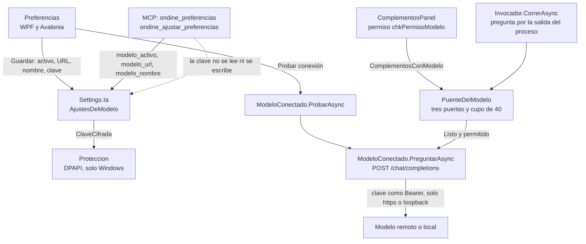

# Asistente de IA (modelo conectado)

**Qué hace:** habla con un modelo de lenguaje por API compatible con OpenAI, en la nube o en la
propia máquina (Ollama, LM Studio), y solo lo usan los complementos a los que se da permiso uno a
uno, por un puente que nunca les entrega la clave.

## Piezas y dependencias

**Quién lo usa:**

- **Interfaces.** Las ventanas de Preferencias de WPF y de Avalonia editan activo, dirección,
  nombre y clave, y «Probar conexión» llama a `ModeloConectado.ProbarAsync`. La ventana de
  complementos (`ComplementosPanel`, en las dos interfaces) muestra el permiso del modelo y crea
  un `PuenteDelModelo` en cada ejecución (`Puente(c)` en `CorrerAsync`).
- **Complementos.** Solo los que declaran `"modelo": true` (`Complemento.PideModelo`) y tienen
  permiso concedido. Preguntan escribiendo en su salida y reciben solo el texto de vuelta.
- **MCP.** Solo lee y cambia `modelo_activo`, `modelo_url` y `modelo_nombre`, con
  `ondine_preferencias` y `ondine_ajustar_preferencias` (estas dos últimas piden «confirmar»).
  La clave no sale ni entra. El MCP no llama al modelo ni ejecuta complementos: no referencia
  `Invocador` ni `PuenteDelModelo`.
- **CLI.** No lo usa.
- **Motor de catálogos (Reindex, Organizar) y el encargo de catálogo.** Ninguno referencia
  `Ia/`. El encargo no llama al modelo.

## Huecos conocidos

- **La clave no se queda atada a la dirección.** `ClaveCifrada` no se toca cuando cambia
  `BaseUrl`, y `PreguntarAsync` solo comprueba si la dirección nueva es https o loopback. Si un
  agente del MCP cambia `modelo_url` a otro host https, la siguiente pregunta de un complemento
  con permiso manda la clave de la cuenta a ese host como `Bearer`. La ventana hace lo mismo si
  se cambia la URL y se deja la clave vacía.
- **En Linux y macOS, la clave se pierde sin aviso, también en «Probar conexión».**
  `Proteccion.Cifrar` devuelve vacío fuera de Windows, así que `PonerClave` no guarda nada.
  `ProbarIa` de Avalonia pone la clave en un clon, y `ProbarAsync` la lee como vacía: la
  prueba sale sin cabecera `Authorization` y el rótulo muestra el error del servidor, no que la
  clave no llegó. Está anotado en `docs/funcionalidades/preferencias.md`; aquí el efecto es que
  la prueba engaña.
- **El MCP dice que el modelo es «para los catálogos».** `Mcp/Preferencias.cs` y
  `Mcp/Catalogo.cs` lo describen así, pero el único consumidor es el puente de complementos. Un
  agente que active el modelo esperando mejorar catálogos no consigue nada si ningún complemento
  tiene permiso.
- **El tope de preguntas es por ejecución, no por cuenta.** `PuenteDelModelo.MaxPreguntas` (40)
  vive en la instancia, y cada `CorrerAsync` crea una nueva. Repetir la ejecución da otras 40, y
  no hay ningún límite diario ni por complemento.
- **La puerta de la clave por HTTP no tiene prueba propia.** `ModeloConectadoTests` prueba a mano
  `Endpoint`, `LeerRespuesta` y `PuedeLlevarClave`, pero ninguna prueba llama a `PreguntarAsync`
  ni a `ProbarAsync`. `PuenteDelModeloTests` sustituye la función de pregunta por una falsa, así
  que el camino real (cabeceras, cuerpo de error, recorte del mensaje) no se ejecuta nunca en
  las pruebas.
