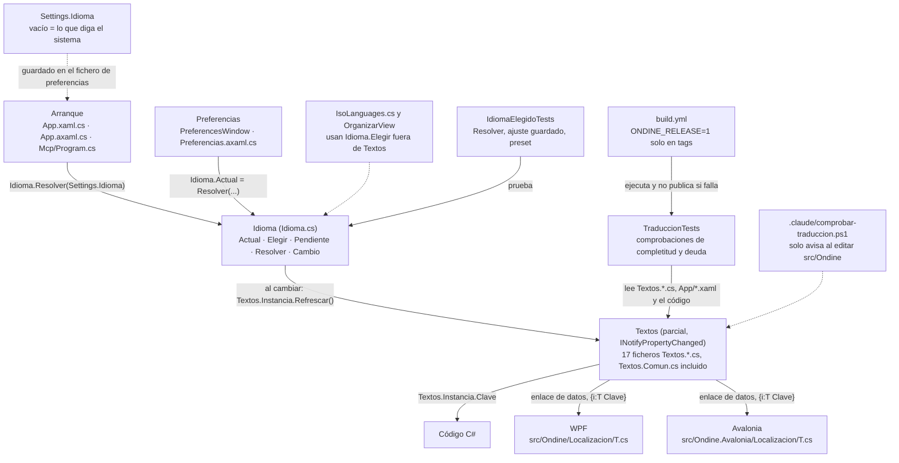

# Localización (textos bilingües)

**Qué hace:** cada texto visible existe en inglés y en castellano a la vez, como una propiedad de la clase única `Textos`. `Idioma.Actual` dice cuál se usa: lo que la persona eligió, o el del sistema si nunca eligió, y en último caso inglés. Un cambio de idioma se propaga a toda la interfaz sin reiniciar.

## Piezas y dependencias



- **`Idioma`** guarda el idioma en curso y ofrece `Elegir(en, es)`, que exige las dos versiones,
  y `Pendiente(es)`, que deja un texto solo en castellano como deuda anotada. `Resolver` convierte
  lo guardado (por ejemplo `es-ES`) en uno de los idiomas admitidos.
- **`Textos`** es un singleton con una propiedad por texto. Sus partes viven en `Textos.*.cs`,
  una por pantalla, y lo que se repite va en `Textos.Comun.cs`.
- **`{i:T}`** es la extensión de marcado de WPF y de Avalonia. Devuelve un enlace, no una cadena,
  así que al cambiar de idioma la interfaz se redibuja sola. Las dos leen el mismo catálogo, que
  vive en el motor.
- **`Settings.Idioma`** es el ajuste guardado. Vacío significa «lo que diga el sistema».

## Cómo se añade un texto nuevo

1. **Mientras se desarrolla**, escribe la propiedad en el fichero parcial de su pantalla
   (`src/Ondine.Core/Localizacion/Textos.<Pantalla>.cs`) solo en castellano:

   ```csharp
   public string RecortesRehacer => Idioma.Pendiente("Rehacer el corte");
   ```

   Si es una pantalla nueva, crea su fichero parcial. Si el texto se repite en varias pantallas,
   ponlo en `Textos.Comun.cs` para traducirlo una sola vez.

2. **Antes de cortar versión**, cambia `Idioma.Pendiente` por `Idioma.Elegir` con el inglés primero:

   ```csharp
   public string RecortesRehacer => Idioma.Elegir("Redo the cut", "Rehacer el corte");
   ```

3. **Úsalo.** En XAML, `Content="{i:T RecortesRehacer}"` (WPF necesita
   `xmlns:i="clr-namespace:Ondine.Localizacion"`; Avalonia, `xmlns:i="clr-namespace:Ondine.Ava.Localizacion"`).
   En C#, `Textos.Instancia.RecortesRehacer`.

4. **Reglas del texto:** inglés británico; sin rayas largas (ni la de U+2014 ni la de U+2013); los marcadores
   `{0}`, `{1}` idénticos en los dos idiomas; no se traducen rutas, códecs, `ffmpeg`, `Ondine`,
   `Plex`, `Jellyfin`, `Kodi` ni los códigos ISO de idioma.

5. **Comprueba:** `dotnet run --project tests/Reindex.Tests`. Si la versión es de publicación
   (`ONDINE_RELEASE=1`), cualquier `Idioma.Pendiente` que quede hace fallar la prueba y el CI no
   publica.

## Reglas que no se deben romper

1. **Los dos idiomas van en la misma línea.** Nunca un literal visible en XAML ni en C#, y nunca
   el mismo texto repetido en los dos idiomas para callar al compilador.
2. **`Pendiente` es deuda, no atajo.** Se usa mientras la pantalla cambia y se quita antes de
   publicar. Por eso la prueba lo cuenta en cada tanda.
3. **Un idioma guardado que ya no existe cae en el del sistema**, nunca en inglés a secas
   (`Idioma.Resolver`).
4. **Los nombres de presets guardados en otro idioma se reconocen** por la tabla de nombres
   históricos (`PresetStore.NombreVigente`). Sin ella, el preset por defecto desaparece al cambiar
   de idioma.

## Huecos conocidos

- **La prueba de XAML solo mira la app WPF.** `TodaClaveDelXamlExiste` y `NingunTextoSueltoEnXaml`
  recorren `src/Ondine` y no `src/Ondine.Avalonia`. Las claves `{i:T}` de los `.axaml` (unas 558
  distintas) no se comprueban. El comentario de `src/Ondine.Avalonia/Localizacion/T.cs` dice que
  sí lo cubre la misma prueba. Hoy no hay textos sueltos en esos ficheros (solo la marca
  «Ondine»), pero nada lo vigila.
- **Un `Idioma.Pendiente` fuera de `Textos.*.cs` no cuenta como deuda.** `LaDeudaDeTraduccion`
  solo recorre `Textos.*.cs`. Un `Pendiente` escrito en una vista pasaría la comprobación de
  publicación sin que nadie lo vea.
- **La prueba de raya larga solo mira `Elegir` y en una sola línea.** `NiUnaRayaLarga` busca
  `Elegir\([^)]*[\u2013\u2014]` línea a línea. Un `Pendiente` con raya larga no se detecta, y tampoco un
  `Elegir` partido en varias líneas.
- **Los `Elegir` fuera de `Textos.*.cs` no se revisan.** `LasDosVersionesSonDistintas` y
  `LosMarcadoresCuadran` solo leen `Textos.*.cs`. Hay llamadas a `Idioma.Elegir` en
  `src/Ondine.Core/Reindex/IsoLanguages.cs`, `src/Ondine/OrganizarView.xaml.cs` y
  `src/Ondine.Avalonia/OrganizarView.axaml.cs`, y nada comprueba que sus dos idiomas sean
  distintos ni que cuadren los marcadores.
- **El trinquete de literales en código solo ve los que llevan tilde o ñ.**
  `NingunTextoSueltoEnCodigo` cuenta solo los literales con `[áéíóúñÁÉÍÓÚÑ¿¡«»]`. Un texto en
  castellano sin esos caracteres, o un literal en inglés, pasa sin aviso. Además, el tope se indexa
  por nombre de fichero (`Path.GetFileName`) y no por ruta, así que dos ficheros con el mismo nombre
  comparten tope.
- **AGENTS.md cuenta cinco pruebas y `TraduccionTests` tiene siete comprobaciones.** Las cinco de
  la norma más `NingunTextoSueltoEnCodigo` y `LaDeudaDeTraduccion`. La cifra de AGENTS.md está
  desfasada.
