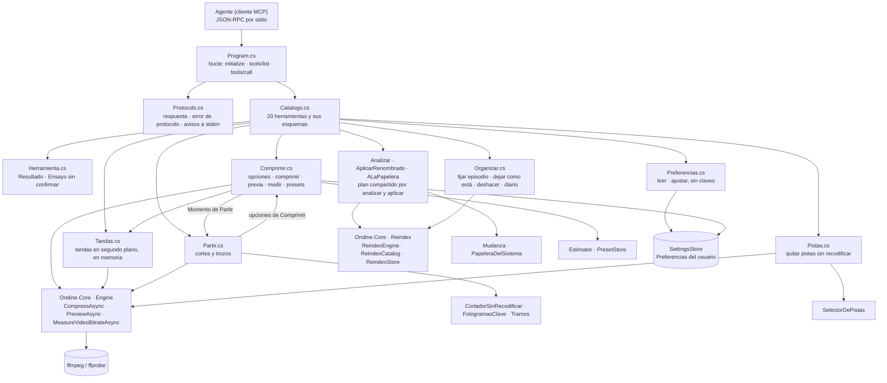

# Servidor MCP: herramientas para que un agente use Ondine

**Qué hace:** expone 20 herramientas por JSON-RPC sobre entrada y salida estándar (una línea por mensaje) para que un agente analice, renombre, parta, comprima y ajuste las Preferencias, llamando al mismo `Ondine.Core` que usan las interfaces, con sus tres reglas: analizar propone, lo que escribe pide `confirmar`, y lo borrado va a la papelera.

## Piezas y dependencias

## Huecos conocidos

- **«Los originales siguen donde estaban» sale siempre.** `Comprimir.Parte` añade esa línea sin
  mirar si los originales se mandaron a la papelera. Con `tras_comprimir: "papelera"` la respuesta
  contradice lo que acaba de pasar, tanto en la tanda directa como en el parte de `ondine_tanda`.
- **En las tandas, la papelera llega al final y no fichero a fichero.** `Tandas.Arrancar` manda los
  originales a la papelera solo cuando termina toda la tanda, aunque el mensaje de arranque dice
  «al terminar cada uno». Y al parar, `CompressAsync` relanza la cancelación (`Engine.cs`, hacia la
  línea 940) y `alTerminar` no se llama: los originales ya comprimidos se quedan donde estaban.
- **«Preguntar» de Preferencias se vuelve «conservar» sin avisar.** Con `tras_comprimir` sin valor,
  `Comprimir.Ejecutar` solo mira si el ajuste es «papelera»; cualquier otra cosa deja el original.
  La descripción promete «lo que digan tus Preferencias».
- **`ondine_partir` con recodificación: el ensayo no valida nada.** `Comprimir.Opciones` solo se
  llama dentro del bucle, después de devolver el ensayo, así que un `codec` o `esmero` inválido se
  ve al confirmar y no antes.
- **Esa misma ruta ignora las Preferencias de disco y hardware.** `Partir` no llama a `Ajustes`:
  `hardware`, `aceleracion` y `margen_disco_mb` quedan en los valores por defecto de
  `EncodeOptions` (hardware sí, margen de 200 MB), no en los guardados.
- **Un fallo del diario de deshacer no se ve.** `Organizar.Apuntar` traga la excepción, pero
  `AplicarRenombrado` contesta igualmente «Se puede deshacer desde la aplicación». Si el diario no
  se escribió, deshacer no tiene nada que devolver.
- **`ondine_comprimir` sin `en_segundo_plano` bloquea la llamada.** Espera con
  `GetAwaiter().GetResult()` hasta el final: sin progreso ni cancelación, y el cliente puede rendirse
  antes por su propio tiempo límite.
- **Dos colas que no se conocen entre sí.** Las tandas MCP viven en el diccionario `Vivas` del
  servidor, no en `ColaDeTrabajos`, y se pierden al cerrar el cliente (ver la ficha de la cola).
- **Ajustar escribe el fichero entero.** `Preferencias.Ajustar` guarda el estado completo sin
  comprobar si la ventana lo cambió entre medias: gana quien guarde el último. La respuesta lo
  advierte, pero no lo evita.
- **Lo que falta, ya declarado en `docs/mcp.md`** (apartado «Lo que todavía no hace»): la cola de
  trabajos y la calidad según el contenido.
