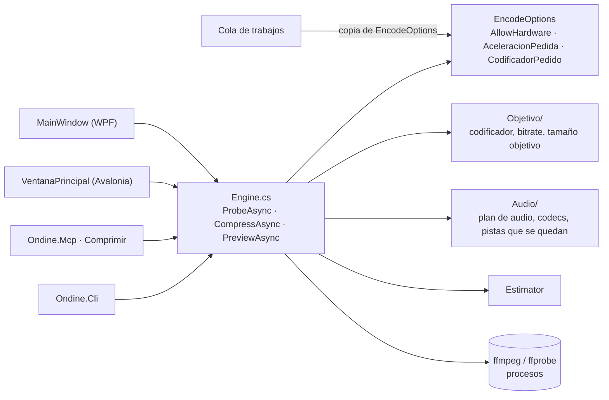

# Motor de compresión

**Qué hace:** convierte un vídeo en otro más pequeño con ffmpeg: sondea el fichero, elige el
codificador que arranca de verdad en esta máquina, calcula el bitrate o el tamaño objetivo,
decide qué pistas de audio y subtítulos se quedan, y comprime. También sirve la previsualización
y la medición de bitrate.

## Piezas y dependencias

## Huecos conocidos

- `Engine.MinFreeBytes` sigue siendo un estático de proceso: lo escriben la CLI y el MCP. Por eso
  el margen de disco no se congela en una tanda encolada. Es el último estático de este tipo.
- `Engine` no tiene pruebas de la compresión en sí (solo del codificador elegido y del
  interruptor de hardware); la compresión real se prueba a mano.
- No hay ficha para los presets (`Preset.cs`); se mencionan aquí porque `Preset` viaja con
  `EncodeOptions`.
