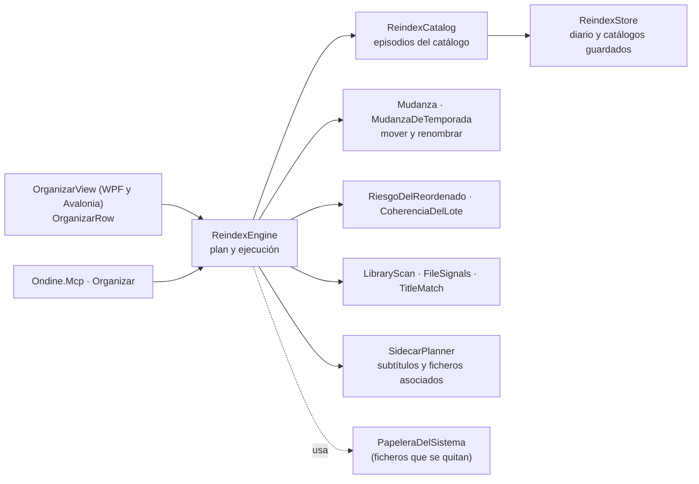

# Organizar

**Qué hace:** identifica los episodios de una biblioteca de series contra un catálogo, propone
el nuevo nombre y la carpeta de cada fichero, y los mueve o renombra. Antes de tocar nada muestra
el plan, con los riesgos (choques de nombre, temporadas a medias).

## Piezas y dependencias

## Huecos conocidos

- **Dos vistas por separado.** WPF y Avalonia mantienen `OrganizarView` y `OrganizarRow` por
  duplicado (miles de líneas cada una). Un cambio de comportamiento hay que hacerlo dos veces.
- **Sin pruebas de interfaz.** La lógica tiene pruebas; la pantalla no.
- **Acoplamiento con Preferencias:** `CarpetaTemporadaIdioma` se decide en esta pantalla y se
  guarda en Ajustes.
- **Fuera de la ficha:** la parte de «más allá de las series» (epic #153) aún no tiene código
  propio distinto; ver el ROADMAP.
