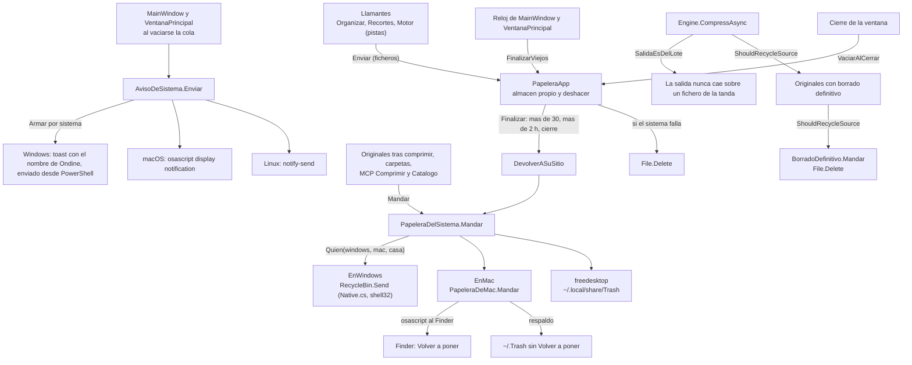

# Papelera y avisos del sistema

**Qué hace:** manda a la papelera de cada sistema (Shell en Windows, Finder en macOS, carpetas freedesktop en Linux) lo que la app promete que va a la papelera, mantiene una papelera propia con deshacer que se finaliza hacia la del sistema, borra de verdad solo con la opción de borrado definitivo, y lanza un aviso del sistema al terminar: una vez por cola vaciada, con el total de sus tandas.

## Piezas y dependencias

## Huecos conocidos

1. **Borrado silencioso al finalizar.** El comentario de `PapeleraApp.Finalizar` dice que nunca se
   borra sin pasar por la papelera, pero si `EnviarASistema` devuelve false hace `File.Delete` sobre
   el fichero. Pasa en los tres disparadores (más de 30 entradas, más de 2 h, cierre), así que un
   fallo de la papelera del sistema acaba en pérdida.
2. **Carpetas fuera del deshacer.** Borrar una carpeta desde la interfaz
   (`foreach (var d in dirs) PapeleraDelSistema.Mandar(d);` en `MainWindow.xaml.cs` y en
   `VentanaPrincipal.axaml.cs`) va directo a la papelera del sistema, sin pasar por `PapeleraApp`,
   así que no hay Ctrl+Z. Además ignora el resultado: las filas salen de la lista y de la cola aunque
   el envío haya fallado.
3. **Respaldo de macOS sin distinguirlo.** `PapeleraDeMac.Mandar` devuelve solo un bool. Si el Finder
   no responde (permiso de automatización denegado o los diez segundos de espera), el fichero acaba
   en `~/.Trash` sin «Volver a poner», y quien llama no puede saber que se usó el respaldo.
4. **Respaldo de Windows hacia una carpeta que el Explorador no mira.** Si
   `PapeleraDelSistema.EnWindows` se deja a null, `Mandar` cae en `~/.local/share/Trash`. Hoy no pasa
   porque ambas ventanas lo conectan al arrancar y el valor por defecto es el mismo; es un fallo
   latente.
5. **Cada aviso de Windows arranca un proceso nuevo de PowerShell.** Es el vehículo para llamar a la API de
   notificaciones, porque el proyecto no admite paquetes NuGet. El nombre que ve el usuario es el de Ondine
   (`AumidWindows`, registrado en el perfil al enviar), pero el proceso sigue existiendo. Está en `AvisoDeSistema`.
6. **Resultado descartado en el MCP.** `ALaPapelera` en `src/Ondine.Mcp/Comprimir.cs` ignora el bool
   de `PapeleraDelSistema.Mandar`, así que un envío fallido no deja ningún rastro dentro de esa función.
