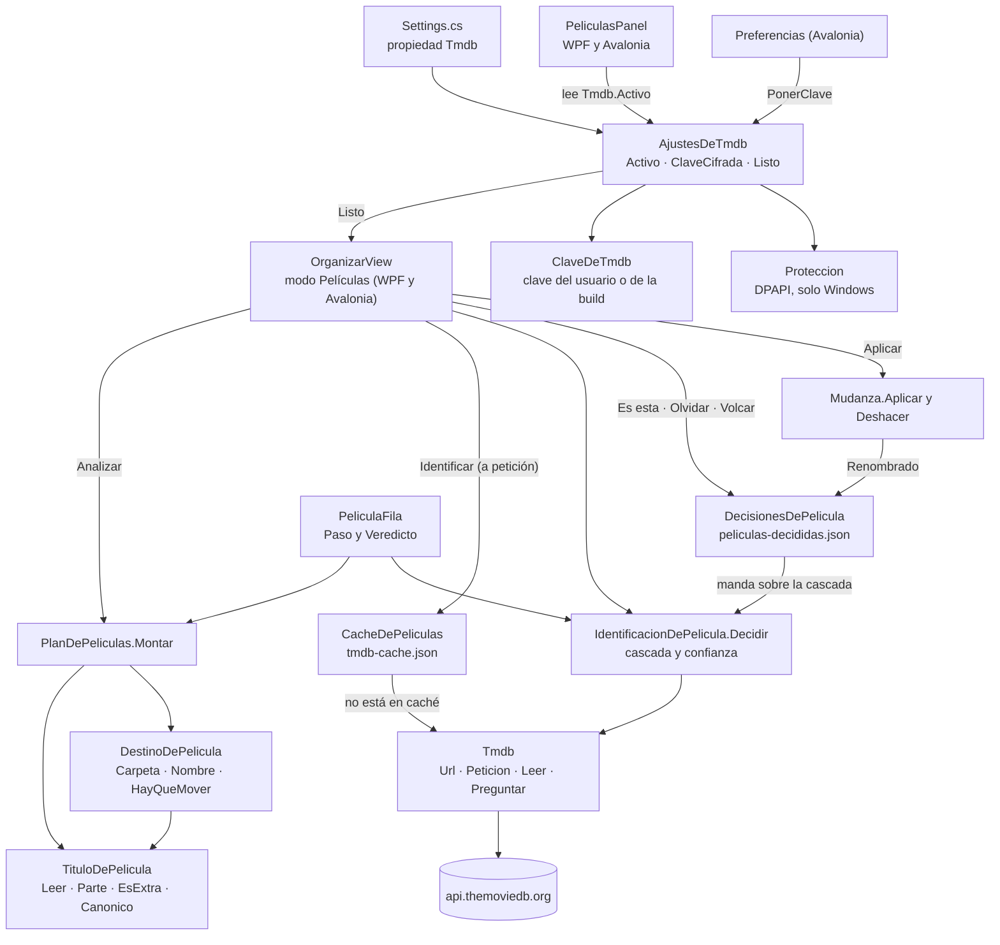

# Películas

**Qué hace:** lee título y año de cada fichero de una carpeta, propone su sitio canónico (`Título (Año)/Título (Año).ext`) o un renombrado dentro de su colección, e identifica cada película contra TMDb solo cuando las señales cuadran; lo dudoso se enseña, lo decide una persona y la decisión se recuerda.

## Piezas y dependencias

## Reglas que no se deben romper

1. **Una película mal identificada es peor que una sin identificar.** Solo se aplica un veredicto
   `Segura` (`SePuedeAplicar`). Lo `Dudosa` se enseña en la columna «Por qué» y no entra en el plan.
2. **Lo que decide el usuario manda sobre la cascada** y no se vuelve a validar contra los candidatos
   de hoy: TMDb puede contestar otra cosa mañana.
3. **Un fallo de red no se guarda como «no existe».** `Tmdb.Preguntar` devuelve `null` si no pudo
   preguntar, y la caché solo guarda respuestas reales. La caché no caduca a propósito.
4. **Identificar es un paso aparte, a petición.** Nunca pasa al abrir ni al analizar, y con
   `Activo` apagado no sale nada a internet.
5. **El token v4 va en la cabecera, nunca en la URL.** Una clave v3 sí va como parámetro (ver huecos).
6. **Un extra (tráiler, escena eliminada) no se renombra ni se pregunta por él.** Renombrarlo lo
   convertiría en otra versión de la película a ojos del servidor.
7. **Una carpeta con más de una película es una colección y no se desmonta.** Dentro se renombra el
   fichero; nada sale de su sitio.

## Huecos conocidos

- **En Avalonia fuera de Windows, la clave de TMDb no se guarda.** `Proteccion.Cifrar` devuelve
  cadena vacía sin DPAPI (`AjustesDeModelo.cs`), `AjustesDeTmdb.PonerClave` guarda ese vacío y
  `Preferencias.axaml.cs` no avisa. La clave que pega el usuario desaparece en silencio, y la app se
  queda con la de la build o sin ninguna.
- **Las escrituras de decisiones y de caché no informan de fallos.** `DecisionesDePelicula.Volcar` y
  `CacheDePeliculas.Volcar` tragan la excepción y devuelven `void`, así que `OrganizarView` no puede
  avisar. Según el propio comentario, las decisiones son datos del usuario: si no se pueden escribir,
  se pierden sin que nadie lo vea.
- **Un fichero de decisiones dañado se sobrescribe.** `DecisionesDePelicula.Abrir` empieza vacío si no
  lee el JSON, y el siguiente `Volcar` con cambios lo reemplaza con `File.WriteAllText` sin copia de
  seguridad.
- **Las decisiones no se podan.** Solo `Renombrado` (al aplicar desde Ondine) y `Olvidar` las tocan.
  Si el usuario mueve o renombra un fichero fuera de Ondine, la decisión queda para una ruta que ya no
  existe, y nada la limpia ni avisa.
- **Las claves de ruta no distinguen mayúsculas.** `DecisionesDePelicula` usa
  `StringComparer.OrdinalIgnoreCase` sobre rutas completas, y lo mismo `_veredictos` en
  `OrganizarView.axaml.cs`. En Linux, con sistemas de ficheros sensibles a mayúsculas, dos ficheros que
  solo difieren en mayúsculas comparten decisión.
- **Identificar no se puede detener.** `IdentificarPeliculas` pide a TMDb una película tras otra, sin
  `CancellationToken` y sin ninguna salida en el código de Avalonia. Con una biblioteca grande y un
  servidor lento, quien lo pulsa espera hasta el final.
- **La orquestación del flujo no tiene pruebas.** Analizar, identificar, elegir, aplicar y deshacer
  viven en `OrganizarView.xaml.cs` y en `OrganizarView.axaml.cs`, escritos por separado. Las reglas de
  decisión sí están probadas en `Reindex.Tests`; el código que las une con la lista de filas no.
- **La clave v3 viaja en la URL.** `Tmdb.Peticion` solo pone la cabecera para el token v4; la clave v3
  va como `api_key=` dentro de la URL. Es lo que pide TMDb para esa clave, pero las URL acaban en los
  registros de cualquier proxy del camino, que es la razón que el propio comentario da para el token.
