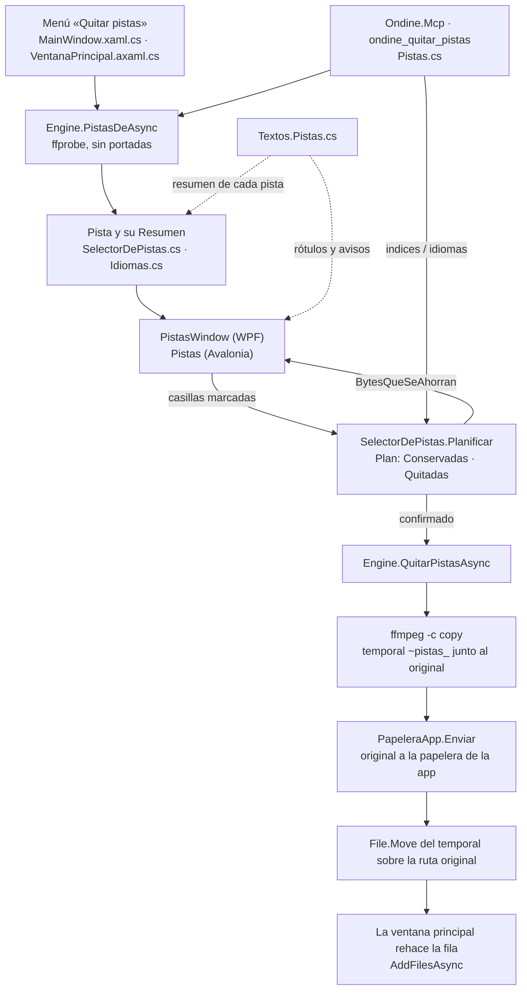

# Quitar pistas sin recomprimir

**Qué hace:** quita pistas de audio o subtítulos de un vídeo copiando los flujos que se quedan
(`-c copy`), sin recodificar nada, y enseña cuánto se ahorra antes de tocar el fichero. El vídeo
nunca se quita. El original va a la papelera propia de la app antes de sustituirse.

## Piezas y dependencias

`SelectorDePistas` (en `Pistas/`) es el núcleo puro: decide qué queda y qué se va, calcula el ahorro
y construye los argumentos de ffmpeg. `Engine` lee las pistas con ffprobe y ejecuta el remux. Las
tres puertas de entrada (la ventana de WPF, la de Avalonia y la herramienta MCP) solo recogen las
casillas y llaman al mismo motor.

Lo que NO es de este bloque: `Audio/PistasQueSeQuedan.cs` decide qué pistas de audio se conservan
al COMPRIMIR, por idioma elegido. Es otra regla, de la ficha del motor, aunque se llame igual y
tenga su propia prueba (`PistasQueSeQuedanTests.cs`).

## Huecos conocidos

- **Si falla el último paso, el original ya está en la papelera de la app y el mensaje no lo dice.**
  `QuitarPistasAsync` envía el original a `PapeleraApp` y luego hace `File.Move(tmp, path)`. Si ese
  movimiento lanza, el `catch` borra el temporal remuxado y devuelve el error sin indicar dónde
  quedó el original. Se recupera con «Deshacer» de la app, pero el usuario no tiene pista de ello.
- **El mensaje del MCP dice mal dónde queda el original.** `QuitarPistas.Ejecutar` escribe «El
  original está en la papelera del sistema», y no es así: va a la papelera propia de la app, que
  solo pasa a la del sistema cuando se acumula.
- **El MCP confunde un fallo de lectura con un fichero sin pistas.** `PistasDeAsync` devuelve una
  lista vacía, sin lanzar, cuando ffprobe no puede leer el fichero. El MCP responde «Ese fichero no
  declara ninguna pista», mientras que la interfaz sí distingue ese caso con `MainPistasNoLeidas`.
- **No se mira si el fichero está en la cola ni si se está comprimiendo.** Los dos manejadores de
  «Quitar pistas» solo comprueban que el fichero exista, y ningún código desactiva `miCtxPistas`.
  El remux puede sustituir el fichero mientras ffmpeg lo lee.
- **El MCP compara el idioma tal cual.** `idiomas` se cruza con `string.Equals` sobre el código del
  fichero, sin normalizar las variantes ISO 639-2 (`fre` frente a `fra`). Un fichero etiquetado
  `fre` no casa con «fra», aunque la descripción de la herramienta ponga ese ejemplo.
- **El código de la ventana está duplicado.** `PistaVista`, `Refrescar` y `QuitarAsync` existen
  casi iguales en `PistasWindow.xaml.cs` y en `Pistas.axaml.cs`. Un arreglo en una hay que
  repetirlo en la otra.
- **La ventana de WPF no tiene comprobación de interfaz.** `tests/Ui.Smoke/Program.cs` la deja sin
  cubrir. La de Avalonia sí, con `Comprobacion.CorrerPistas`.
- **Las pruebas viven en `Program.cs`, dentro de la sección `QuitarPistas`.** No hay un fichero
  `*Tests.cs` propio, así que la ficha apunta al fichero general.
