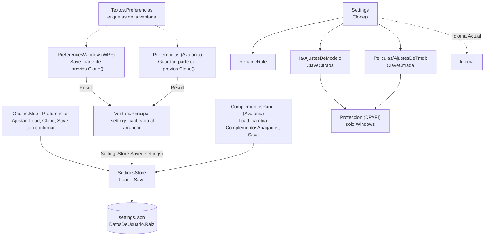

# Preferencias y ajustes persistidos

**Qué hace:** guarda en `settings.json` las preferencias de la app (idioma, ajustes de
compresión, disco, aceleración, modelo y TMDb) y las devuelve a las ventanas de Preferencias
y al agente del MCP. Las claves del modelo y de TMDb van cifradas aparte, con DPAPI en Windows.

## Piezas y dependencias

## Huecos conocidos

- **Un `settings.json` que no se lee se pierde al guardar.** `SettingsStore.Load` traga cualquier
  error y devuelve ajustes por defecto. Basta un valor de enum que no reconoce (por ejemplo un
  `AfterCompress` con otro nombre) para que toda la carga falle; el siguiente `Save` escribe los
  valores por defecto encima del fichero original, sin copia de seguridad.
- **Un guardado fallido no avisa.** `SettingsStore.Save` tiene un `catch {}` vacío y la ventana
  de Preferencias se cierra como si hubiera guardado. Además la escritura es directa
  (`File.WriteAllText`), sin fichero temporal: un corte a mitad deja el JSON truncado y cae en el
  caso anterior.
- **Se pierde una actualización entre ventanas.** `VentanaPrincipal` guarda su `_settings`
  cacheado (cargado al arrancar) cada vez que cambia algo, por ejemplo al marcar «subcarpetas» o
  al terminar una compresión que aprende el factor de complejidad. Si antes `ComplementosPanel`
  apagó un complemento con su propio `Load`/`Save`, ese cambio se pisa. El mensaje de
  `ondine_ajustar_preferencias` avisa de lo mismo para la ventana, pero la ventana principal
  tampoco recarga.
- **En Linux y macOS la clave no se guarda y la ventana no lo dice.** `Proteccion.Cifrar` devuelve
  vacío fuera de Windows, así que `PonerClave` deja `ClaveCifrada` vacía. Es lo previsto (no se
  guarda en claro), pero la ventana de Avalonia acepta la clave del modelo o de TMDb, la muestra
  como «sin poner» tras guardar y no explica por qué.
- **`Settings.Clone` es incompleto.** Copia a mano solo `Ia`, `Tmdb` y `ComplementosConModelo`.
  `Rename`, `RenameSearchHistory`, `RenameReplaceHistory` y `ComplementosApagados` siguen
  compartidos con el original, así que editar la copia y cancelar sí cambia lo de verdad. Hoy
  las ventanas no tocan esas listas en la copia, pero el primero que lo haga rompe la garantía.
- **El MCP ignora en silencio un valor del tipo equivocado.** En `Entero` y `Bandera`, un valor que
  no se convierte (por ejemplo `"margen_disco_mb": "mucho"`) sale sin error ni cambio, así que la
  respuesta puede ser «No hay nada que cambiar» o un guardado a medias. `idioma_audio` tampoco se
  valida: acepta cualquier texto.
- **El cifrado de las claves solo se prueba en Windows.** `ClaveDeTmdbTests` y
  `ModeloConectadoTests` hacen el viaje completo de la clave (guardar, cifrada, recuperar), pero
  solo si `OperatingSystem.IsWindows()`. En Linux la prueba sale como «saltado», así que el CI no
  vigila ese camino.
