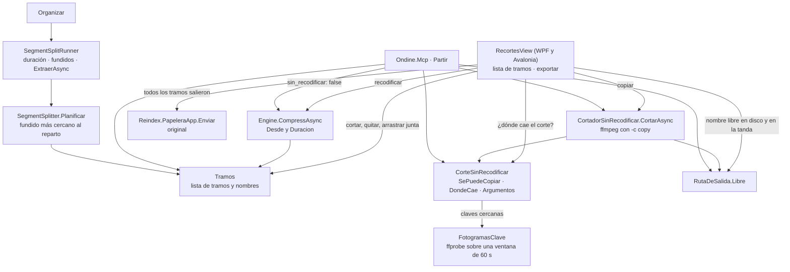

# Recortes y partir

**Qué hace:** parte un vídeo en trozos o se queda con uno. Puede copiar los paquetes sin recodificar (sin perder calidad y en segundos), pero avisa antes de dónde caerá el corte, que siempre retrocede al fotograma clave anterior. El MCP ofrece lo mismo con la herramienta `Partir`, y Organizar usa el planificador de segmentos para partir episodios con varias historias.

## Piezas y dependencias

## Huecos conocidos

- **El corte sin recodificar no mira el código de salida.** `CortadorSinRecodificar.CortarAsync`
  decide con «existe y pesa más de cero», y `CorrerAsync` solo devuelve el texto de ffmpeg. Un
  ffmpeg que muere a mitad deja un trozo truncado que cuenta como bueno, y si salen todos, las
  dos pantallas ofrecen mandar el original a la Papelera. `SegmentSplitRunner.ExtraerAsync` sí
  mira el código de salida, así que hay dos cortes con garantías distintas. Además, el de
  Organizar tiene sus propios argumentos de ffmpeg en vez de usar `CorteSinRecodificar.Argumentos`.
- **`CortadorSinRecodificar`, `FotogramasClave` y `SegmentSplitRunner.ExtraerAsync` no tienen
  pruebas.** `PartirPorMcpTests` dice que el cortador «ya tiene sus pruebas», pero ningún fichero
  de `tests/` llama a `CortarAsync`. Las pruebas cubren los argumentos y la regla de retroceder,
  no la cancelación, los errores de ffmpeg ni la lectura de claves.
- **`DondeCae` puede dar un corte posterior a lo pedido.** Si la ventana de `FotogramasClave` solo
  trae claves por encima del pedido (un fichero con más de 60 s sin fotograma clave antes del
  punto), el código toma la primera, que queda después. El comentario dice «siempre retrocede», y
  ninguna prueba cubre este caso.
- **Partir por MCP no ensaya el inicio de un trozo pedido con `desde`.** El ensayo recorre
  `tramos.Skip(1)`. Con `desde` hay un único trozo, así que no se muestra nada, y con
  `sin_recodificar` el inicio también se mueve al fotograma clave anterior sin avisar.
- **La rama de recodificar de la versión WPF no reserva nombres.** `reservadas` solo se usa en la
  rama de copiar. La de recodificar pone `NombreSalida = t.Nombre` con `Force = true`, así que dos
  tramos con el mismo nombre se pisan. La versión Avalonia ya comparte la reserva, y su comentario
  explica por qué hacía falta.
- **Los textos de `Ondine.Mcp` van a pelo en castellano.** `Partir.cs` no usa `Textos`, y ningún
  fichero de `src/Ondine.Mcp` lo hace, al revés de lo que pide la norma de traducción del proyecto.
