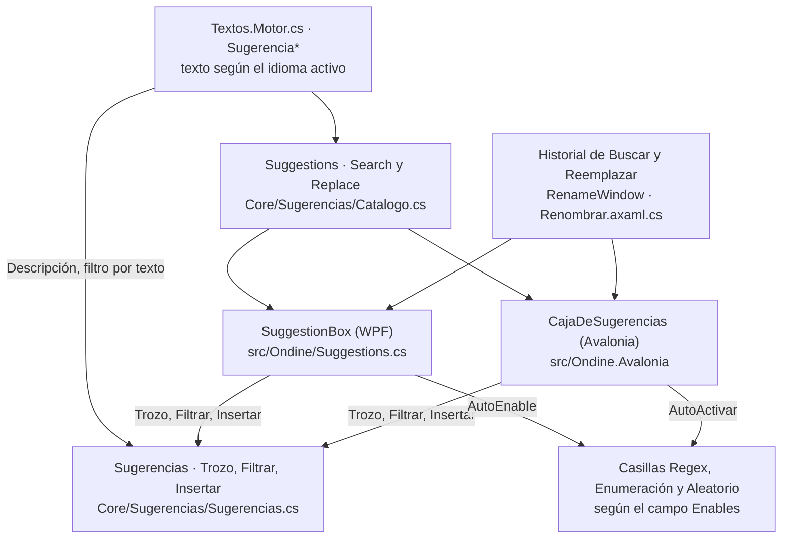

# Sugerencias (autocompletado de renombrar)

**Qué hace:** en los campos Buscar y Reemplazar por de la ventana de renombrar, ofrece patrones regex o variables de plantilla según lo que se escribe, y al elegir uno sustituye solo el trozo que se estaba escribiendo y activa la opción que necesita (regex, enumeración o aleatorio).

## Piezas y dependencias

El motor (`Sugerencias`) es aritmética de cadenas y se prueba sin ventana en
`tests/Reindex.Tests/SugerenciasTests.cs` (que `Program.cs` llama desde `Todas()`). Las dos
interfaces solo cablean: abrir, cerrar, moverse con las flechas y aceptar. El catálogo
(`Suggestions`) se rehace en cada acceso para que la descripción salga en el idioma activo.

## Huecos conocidos

- **Sin pruebas del catálogo.** Ningún test toca `Suggestions.Search` ni `Suggestions.Replace`.
  No se comprueba que cada `Enables` sea uno de los tres valores que entienden los dos `switch`
  (`"regex"`, `"enum"`, `"rand"`; hay 24, 6 y 4 entradas así). Un typo no revienta: la casilla
  simplemente no se marca. Los `switch` de `RenameWindow.xaml.cs` y `Renombrar.axaml.cs` no
  tienen `default`, y `tests/Ui.Smoke` solo construye `RenameWindow`.
- **El `$` de Buscar.** En Buscar el `$` es el ancla de final de nombre, no una variable, pero
  `Sugerencias.Trozo` lo trata igual en los dos campos. Al escribir `$` en Buscar, `Filtrar`
  entra en modo prefijo y solo deja lo que empieza por `$`: se pierde la búsqueda por contenido
  y por descripción justo cuando el patrón acaba de empezar.
- **Buscar por descripción depende del idioma.** `Filtrar` compara con la descripción en el
  idioma activo, así que escribir «principio» con la interfaz en inglés no encuentra nada. Y
  todo el historial lleva como descripción `SugerenciaUsadoRecientemente`: escribir «usado» o
  «recently» devuelve el historial entero.
- **Tab acepta en vez de avanzar.** Con el desplegable abierto y una fila marcada, Tab acepta la
  sugerencia (lo mismo en WPF y en Avalonia), así que no sirve para saltar de campo cuando hay
  coincidencias.
- **Dos copias del mismo cableado.** `SuggestionBox` (WPF) y `CajaDeSugerencias` (Avalonia)
  hacen lo mismo. Mientras convivan las dos interfaces, un cambio de comportamiento hay que
  hacerlo dos veces.
